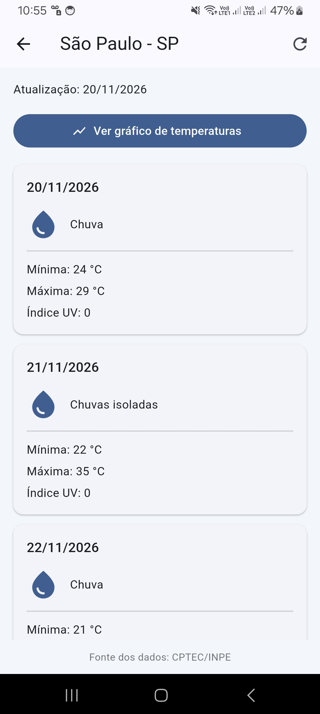
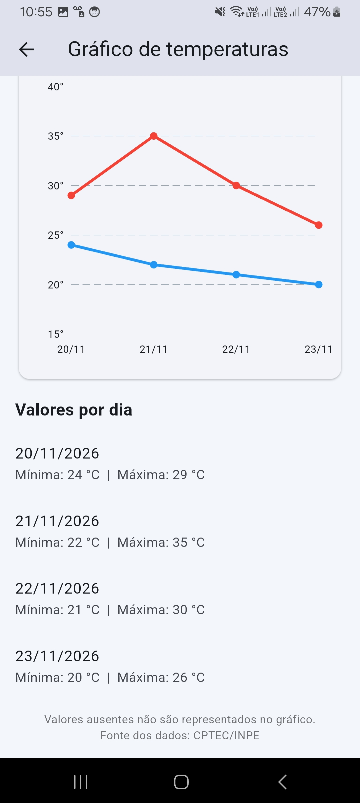

# Previsão do Tempo

Aplicativo Flutter para consultar a previsão do tempo de cidades brasileiras, utilizando o serviço XML do CPTEC/INPE.

## Funcionalidades

- Pesquisa de cidades pelo nome, com exibição da cidade e da UF.
- Consulta utilizando o identificador retornado pelo CPTEC/INPE.
- Previsão de quatro dias, exibindo todos os dias retornados pelo serviço.
- Exibição de data, temperaturas mínima e máxima, descrição e ícone da condição do tempo.
- Exibição do índice ultravioleta e da data de atualização, quando disponíveis.
- Atualização pelo botão na tela ou pelo gesto de puxar a lista para baixo.
- Gráfico de temperaturas mínimas e máximas.
- Cadastro e remoção de cidades favoritas.
- Persistência local dos favoritos.
- Navegação entre pesquisa, previsão, gráfico e favoritos.
- Indicadores de carregamento e mensagens para pesquisas sem resultados, falhas de conexão, tempo de espera excedido e respostas inválidas.
- Tratamento de campos ausentes.

## Tecnologias e bibliotecas

| Tecnologia ou biblioteca | Utilização |
| --- | --- |
| Flutter e Dart | Desenvolvimento do aplicativo |
| http | Requisições HTTP ao CPTEC/INPE |
| xml | Interpretação das respostas XML |
| shared_preferences | Persistência local das cidades favoritas |
| fl_chart | Gráfico de temperaturas |
| intl | Formatação de datas e números |
| flutter_test | Teste da tela inicial |
| flutter_lints | Análise estática do código |

As versões utilizadas estão declaradas no `pubspec.yaml` e registradas no `pubspec.lock`.

## Como executar

### Pré-requisitos

- Flutter instalado e configurado, com Dart compatível com o `pubspec.yaml`.
- Android SDK configurado.
- Celular Android com depuração USB ativada ou emulador Android.
- Conexão com a internet para pesquisar cidades e consultar previsões.

### Execução

Abra o terminal na pasta do projeto e instale as dependências:

```bash
flutter pub get
```

Confira os dispositivos disponíveis:

```bash
flutter devices
```

Execute no dispositivo desejado, substituindo o identificador:

```bash
flutter run -d IDENTIFICADOR_DO_DISPOSITIVO
```

O aplicativo foi testado em um celular Android físico. A execução no navegador pode depender das restrições de acesso entre origens do serviço.

## Como utilizar

1. Digite o nome de uma cidade e toque em **Pesquisar**.
2. Toque no resultado desejado para abrir a previsão.
3. Utilize o botão de atualizar para consultar novamente os dados.
4. Toque em **Ver gráfico de temperaturas** para comparar mínimas e máximas.
5. Na pesquisa, toque na estrela ao lado de uma cidade para salvá-la.
6. Acesse a estrela no topo da pesquisa para abrir os favoritos.
7. Na tela de favoritos, toque na cidade para consultar sua previsão ou na lixeira para removê-la.

## Persistência local

Os favoritos são armazenados no dispositivo utilizando `SharedPreferencesAsync`, da biblioteca `shared_preferences`.

A lista é convertida para JSON e salva na chave `cidades_favoritas`. Cada cidade contém:

- Identificador retornado pelo CPTEC/INPE.
- Nome da cidade.
- Unidade da federação.

O identificador é utilizado para evitar favoritos duplicados. As cidades permanecem salvas após fechar e reabrir o aplicativo.

Somente os favoritos são persistidos. As previsões são consultadas pela internet e mantidas em memória enquanto a tela está aberta. Caso uma atualização falhe, a previsão já carregada permanece visível com uma mensagem de erro.

## Serviço CPTEC/INPE

### Pesquisa de cidades

```text
http://servicos.cptec.inpe.br/XML/listaCidades?city=jacarei
```

O nome pesquisado é normalizado para minúsculas e sem acentos. A resposta XML fornece nome, UF e identificador das localidades.

### Previsão de quatro dias

```text
http://servicos.cptec.inpe.br/XML/cidade/CODIGO_DA_CIDADE/previsao.xml
```

O código utilizado é o identificador retornado pela pesquisa, sem utilizar códigos fixos no aplicativo.

As siglas meteorológicas são convertidas em descrições compreensíveis. Informações ausentes são apresentadas como não informadas, e temperaturas ausentes não são representadas no gráfico.

A implementação utiliza HTTP, sem criptografia, com permissão de tráfego configurada especificamente para `servicos.cptec.inpe.br` no Android.

Documentação: https://servicos.cptec.inpe.br/XML/

**Fonte dos dados: CPTEC/INPE.**

## Organização do código

- `lib/models`: modelos de cidade e previsão.
- `lib/services`: consultas HTTP, leitura de XML e persistência local.
- `lib/pages`: telas de pesquisa, previsão, gráfico e favoritos.
- `lib/widgets`: cartão de previsão.
- `test`: teste automatizado da tela inicial.
- `docs/screenshots`: capturas das funcionalidades.

## Verificação

Para analisar o código:

```bash
flutter analyze
```

Para executar o teste automatizado:

```bash
flutter test
```

O teste automatizado verifica a presença dos elementos principais da tela inicial. As consultas ao serviço, a navegação, os gráficos e a persistência dos favoritos foram verificados manualmente no celular.

## Capturas de tela

### Pesquisa de cidades


### Previsão do tempo



### Gráfico de temperaturas



### Cidades favoritas

